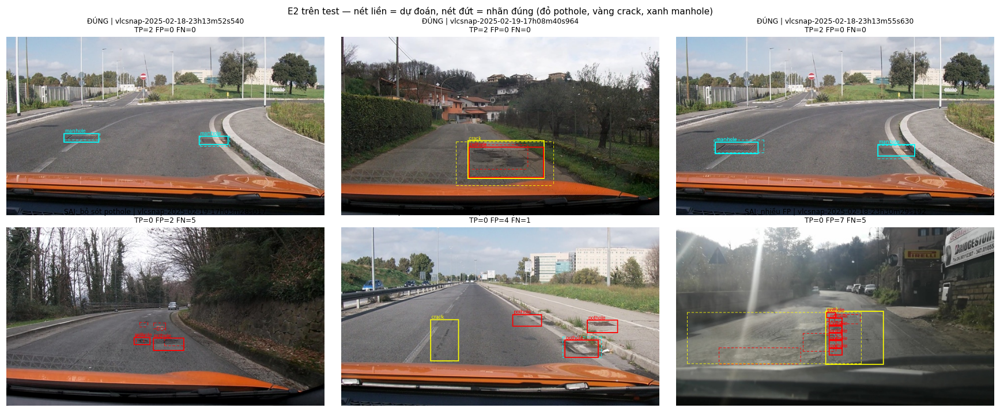

Họ tên: Nguyễn Hoàng Sơn — 2A202602457
`dataset_version`: d10-21e4070301

## Bảng tổng hợp (số của bạn, lấy từ `report/evidence/*.json`)

Mọi setup: Qwen3-VL-4B-Instruct, QLoRA NF4 (double quant), `visual` + `lm_head` giữ fp16, 300 bước, batch 2 × accum 4, lr 2e-4, test 311 ảnh, IoU ≥ 0,5 cùng lớp. Phần cứng: Kaggle 2× Tesla T4 (mỗi thí nghiệm 1 GPU, E1 ‖ E2 và E3 ‖ E4 chạy song song).

| Mã | Setup | Tham số huấn luyện | VRAM đỉnh (GB) | Phút | F1 | CI95 | FP/ảnh | F1 pothole | F1 crack | F1 manhole |
|---|---|---|---|---|---|---|---|---|---|---|
| E0 | zero-shot | 0 | — (chỉ suy luận) | 0 | 0,095 | 0,069–0,125 | 1,10 | 0,157 | 0,028 | 0,213 |
| E1 | LoRA LLM | 33.030.144 | 6,44 | 42,2 | 0,273 | 0,235–0,311 | 1,20 | 0,189 | 0,207 | 0,516 |
| E2 | + projector | 142.135.296 | 8,13 | 49,7 | 0,327 | 0,291–0,368 | 1,12 | 0,157 | 0,285 | 0,564 |
| E3 | + LoRA ViT | <điền: chờ Version #2> | | | | | | | | |
| E4 | data_size = 0,1 (gốc E2) | <điền: chờ Version #2> | | | | | | | | |

Thêm: `parse_valid_rate` E0/E1/E2 = 0,923 / 0,994 / 0,997; mean IoU của cặp khớp = 0,600 / 0,678 / 0,684.
Đường loss: `report/figures/loss_curves.png` (E1: 2,11 → ~0,58 trung bình 10 bước cuối; E2: 2,11 → ~0,54).

## 10 câu hỏi (trả lời bằng **số của bạn**, không chép lại tài liệu)

### Câu 1 — Kiến trúc: ViT, projector và LLM của Qwen3-VL-4B có bao nhiêu tham số mỗi khối, và E1/E2/E3 mỗi cái cập nhật khối nào?
Đếm bằng `lab.train.param_counts()` (dựng model trên thiết bị *meta*; không đếm trên model 4-bit vì `Params4bit` đóng gói 2 giá trị/byte nên `numel()` chỉ còn một nửa):

| Khối | Tham số |
|---|---|
| ViT (24 block + patch/pos embed) | 306.242.560 |
| Projector `visual.merger` | 27.271.680 |
| Projector `visual.deepstack_merger_list` (đặc trưng lớp 5, 11, 17) | 81.833.472 |
| LLM `language_model` (36 lớp, gồm embedding 388,96M) | 4.022.468.096 |
| `lm_head` | 388.956.160 — **chung trọng số** với embedding (`tie_word_embeddings=True`) |
| Tổng thực | ≈ 4,44B (4.826.771.968 trên meta trừ phần `lm_head` bị đếm hai lần) |

- **E1**: chỉ LoRA r=16 trên 252 module của LLM (`q,k,v,o,gate,up,down` × 36 lớp) = 33,03M tham số; ViT và projector đóng băng.
- **E2**: E1 + projector huấn luyện **đầy đủ** ở fp32 → 142,14M; chênh E1 đúng 109.105.152 = merger + deepstack.
- **E3**: E2 + LoRA trên 96 module của ViT (`attn.qkv, attn.proj, mlp.linear_fc1/2` × 24 block) → 348 module LoRA. Lần chạy thử in ra LoRA = 39.321.600 (LLM 33,03M + ViT 6,29M), tức tổng ≈ 148,4M. <điền: xác nhận bằng meta của e3.json>

### Câu 2 — E0: `parse_valid_rate` bằng bao nhiêu, và hai lỗi phổ biến nhất của model gốc là gì (kèm một ví dụ output thô)?
`parse_valid_rate` = **0,923** (24/311 ảnh hỏng). Model gốc *không* bọc ```` ```json ```` và không viết chữ thừa (0/311), không dùng nhãn ngoài 3 lớp, chỉ 1/311 ảnh có toạ độ > 1000 — tức format và thang 0–1000 nó gần như làm đúng. Hai lỗi chính:

1. **Lặp vô hạn → JSON bị cắt**: 20/24 output hỏng không kết thúc bằng `]` vì model sinh box lặp tới hết 384 token. Ví dụ `vlcsnap-2025-02-18-23h13m59s036`:
   `[{"label": "crack", "bbox_2d": [359, 500, 487, 530]}, {"label": "crack", "bbox_2d": [359, 530, 487, 560]}, {"label": "crack", "bbox_2d": [359, 560, 487, 590]}, … [359, 800, 487, 830]}, {"label": "crack", "bbox_2d": [359, 8`
   (y tăng đều 30 mỗi box — "quét" ảnh chứ không nhìn hư hại).
2. **Bịa box / box khổng lồ**: 37 box phủ > 25% khung hình, ví dụ `vlcsnap-2025-02-18-23h08m03s358` → `[{"label": "crack", "bbox_2d": [0, 300, 1000, 700]}]`; thêm 14 box trùng y hệt. Hậu quả rõ nhất ở crack: 266 FP, precision 0,029, F1 0,028.

Ảnh minh hoạ: `report/figures/e0_examples.png`.

### Câu 3 — Thang 0–1000: nếu chấm output theo pixel (hoặc ngược lại) thì F1 ra sao và vì sao? Bạn đã kiểm chứng điều này thế nào?
Chấm lại **cùng** file dự đoán bằng `score.py --coord pixel` (file trong `work/`, không đưa vào evidence):

| | norm1000 (đúng) | coi là pixel |
|---|---|---|
| E0 | 0,095 | **0,000** |
| E1 | 0,273 | **0,000** |
| E2 | 0,327 | **0,000** |

Khi coi số 0–1000 là pixel, `score.py` chia x cho 640 và y cho 360 rồi nhân 1000: x bị kéo giãn ×1,5625, y ×2,78 → box trượt khỏi chỗ đúng, hầu hết ra ngoài khung (y > 1000), không cặp nào đạt IoU ≥ 0,5. Chiều ngược lại (model sinh pixel mà chấm như 0–1000) thì mọi box co về góc trên-trái (64% × 36% khung), cũng gần 0. Thang 0–1000 tách toạ độ khỏi độ phân giải: Qwen3-VL được tiền huấn luyện grounding trên thang này nên E0 đã sinh đúng thang ngay từ đầu, và nhãn huấn luyện phải cùng thang. Kiểm chứng phía nhãn: round-trip YOLO → 0–1000 (số nguyên) → pixel trên 4.737 box, sai số ≤ 0,32 px trừ 35 box nhãn gốc vượt mép ảnh (bị kẹp, lệch tối đa 10 px, IoU vẫn ≥ 0,87) và 1 box suy biến cao 0 px (`train/vlcsnap-00058`).

### Câu 4 — Mask loss: vì sao chỉ tính loss trên phần trả lời? Điều gì xảy ra nếu tính trên cả prompt và token ảnh?
Một ví dụ train (`20250216_164325`, 9 box) có **586 token**: 220 token `<|image_pad|>` + ~117 token template/prompt (bị gán −100) và **249 token đáp án** (JSON + `<|im_end|>`, kiểm tra bằng cách giải mã riêng các vị trí `labels != -100`). Lý do chỉ học phần trả lời:
- Prompt giống hệt nhau ở mọi ví dụ → dự đoán nó là việc vô ích, loss trên đó nhanh chóng ~0 và làm loss trung bình trông thấp giả.
- 220 token ảnh chỉ là chỗ giữ chỗ; ở đầu vào chúng bị thay bằng embedding từ ViT, nên "dự đoán token ảnh tiếp theo" không có nghĩa — gradient từ đó là nhiễu đẩy vào LLM/projector.
- Nếu tính cả hai, chỉ 249/586 ≈ 42% token mang tín hiệu thật; tín hiệu cho toạ độ bị pha loãng và model có thể học "nhại" lại prompt. Mình cũng che `\n` sau `<|im_end|>` cuối để model học dừng đúng chỗ — E1/E2 chỉ còn 2 và 1 output bị cắt (so với 20 ở E0).

### Câu 5 — Vì sao không thể huấn luyện đầy đủ projector nếu ViT bị lượng tử hoá 4-bit, và bạn đã xử lý thế nào? Vì sao projector phải ở float32?
Mình **gặp đúng lỗi này**. Với transformers 5.19, `llm_int8_skip_modules=["visual", "lm_head"]` như GUIDE **không** giữ ViT ở fp16: `should_convert_module` dùng `re.match` (neo ở đầu tên), mà tên thật là `model.visual.blocks…`, nên "visual" không khớp → cả ViT lẫn merger thành `Linear4bit`. Dấu hiệu: lần chạy thử E3 đếm projector chỉ **54.579.200** tham số (≈ một nửa 109,1M, vì trọng số 4-bit là `uint8` đóng gói) và dừng với `ValueError: Attempting to unscale FP16 gradients`.
- Trọng số 4-bit là số nguyên đã lượng tử (kèm hằng số scale theo khối), không phải tham số float liên tục → không có gradient và không cập nhật được bằng AdamW; chỉ có thể gắn LoRA lên trên.
- Cách sửa: dùng `"model.visual"` và thêm kiểm tra sau khi nạp (`lab/infer.py`): phải có 0 `Linear4bit` trong visual và 252 trong LLM, nếu không thì dừng. E0 được chạy lại với ViT fp16 (bản cũ ViT 4-bit lưu ở `report/e0_vit4bit.json`: F1 0,088, CI 0,062–0,117 — trùng phần lớn CI với 0,095 nên zero-shot gần như không bị ảnh hưởng).
- Projector ở **float32** vì: (1) `GradScaler` không unscale được gradient fp16 (chính lỗi trên); (2) với lr 2e-4 và Adam, bước cập nhật ~1e-4 nhỏ hơn khoảng cách giữa hai số fp16 quanh |w| ~ 1 (~1e-3) nên bị làm tròn mất. Giá: VRAM E2 − E1 = 8,13 − 6,44 = **1,69 GB**, khớp ước tính 109,1M × (4 B trọng số + 4 B grad + 8 B Adam) ≈ 1,75 GB.

### Câu 6 — Split theo phiên quay: vì sao chia ngẫu nhiên sẽ cho F1 cao giả? Số ảnh và số box từng lớp ở mỗi split là bao nhiêu?

| Split | Ảnh | Box | pothole | crack | manhole | Phiên |
|---|---|---|---|---|---|---|
| train | 1.422 | 3.515 | 1.074 | 1.750 | 691 | 13 |
| val | 276 | 639 | 66 | 470 | 103 | 2 |
| test | 311 | 583 | 121 | 299 | 163 | 3 |

Giao tập phiên giữa các split đều = 0 (kiểm tra trong notebook). Ảnh là frame cắt từ video, frame liền kề gần như trùng nhau (ví dụ test có `…23h13m52s540` và `…23h13m55s630` cách 3 giây, cùng hai nắp cống ở gần cùng vị trí — xem `e2_examples.png`). Chia ngẫu nhiên thì "ảnh test" phần lớn có một bản gần y hệt trong train → model chỉ cần nhớ, F1 đo khả năng nhớ chứ không đo khả năng tổng quát sang con đường/ánh sáng/camera mới; con số sẽ cao giả và không dự báo được hiệu năng khi triển khai. Mình **không** chạy thử split ngẫu nhiên nên không có con số cho mức thổi phồng. Cái giá của split theo phiên là phân bố lớp lệch: val chỉ có 66 pothole (test 121), nên val không đủ để chọn setup theo pothole.

### Câu 7 — So sánh E1/E2/E3: mở projector và LoRA trên ViT có đáng không (F1, CI95, VRAM, thời gian)?
- **E1 → E2 (mở projector)**: F1 0,273 → 0,327 (+0,054), crack 0,207 → 0,285, manhole 0,516 → 0,564; pothole giảm 0,189 → 0,157. Trả thêm 109M tham số, +1,69 GB VRAM, +7,5 phút (42,2 → 49,7). Đáng giá: rẻ, và cải thiện chủ yếu ở định vị (mean IoU 0,678 → 0,684, recall 0,259 → 0,312). Nhưng CI95 hai bên còn chồng nhau ở 0,291–0,311 nên chưa chắc chắn tuyệt đối.
- **E2 → E3 (LoRA ViT)**: <điền: chờ e3.json — F1, CI95, VRAM, phút>

### Câu 8 — Tập test có 311 ảnh: khoảng tin cậy rộng thế nào, và điều đó giới hạn kết luận so sánh các setup ra sao?
CI95 bootstrap theo ảnh (1.000 lần) rộng: E0 0,056; E1 **0,076**; E2 **0,077** điểm F1 — tức ±0,04 quanh điểm ước lượng. Hệ quả:
- **E0 → E1**: chắc chắn (CI 0,069–0,125 và 0,235–0,311 tách xa) — finetune thật sự học được.
- **E1 → E2**: +0,054 nhưng hai CI chồng nhau 0,02; với cách đọc "CI không chồng thì khác biệt rõ", mình chỉ có thể nói E2 *có xu hướng* tốt hơn. (So sánh chặt hơn sẽ là bootstrap ghép cặp trên cùng ảnh cho hiệu F1.)
- **Theo lớp** còn yếu hơn: test chỉ có 121 pothole trong 3 phiên, nên chênh 0,189 vs 0,157 ở pothole là trong mức nhiễu.
- Chỉ 3 phiên test → CI chỉ phản ánh nhiễu lấy mẫu ảnh, không phản ánh nhiễu giữa các *phiên*/điều kiện quay; độ bất định thật còn lớn hơn.
<điền: thêm E3/E4 khi có>

### Câu 9 — Phân tích lỗi theo lớp: lớp nào kém nhất và vì sao (kích thước box, số mẫu, ngữ nghĩa)? Kèm ảnh minh hoạ.
**Pothole kém nhất** (E2: P 0,165, R 0,149, F1 0,157; 91 FP, 103 FN), dù train có 1.074 box pothole — nhiều gần bằng crack.
- **Kích thước**: diện tích trung vị pothole chỉ 0,38% khung (crack 1,35%). Trong test, 65/117 pothole (ảnh parse được) nhỏ hơn 0,5% khung; E2 chỉ bắt được 10/65 trong số đó. Với box ~20×12 px, lệch vài pixel đã làm IoU < 0,5 (ảnh dưới-trái: box dự đoán nằm ngay cạnh pothole thật nhưng không đủ IoU). Mỗi ảnh chỉ có 220 token ảnh (mỗi token ≈ 32×32 px) nên vật nhỏ hơn một token rất khó định vị.
- **Ngữ nghĩa / nhầm lớp**: trong E2, 18 nắp cống bị gọi là pothole (E1: 5) và 14 pothole bị gọi là crack — chỗ vỡ quanh nắp cống và ổ gà trông giống nhau ở độ phân giải này; ảnh dưới-giữa là ví dụ.
- **Lặp box**: ảnh dưới-phải, model xếp chồng 6 box pothole theo chiều dọc — dư âm của lỗi lặp ở E0.
- **Manhole tốt nhất** (F1 0,564, precision 0,70): hình dạng đều, tương phản rõ; lỗi còn lại chủ yếu là nắp nhỏ ở xa (recall 18/64 với box < 0,5%).
- **Crack**: precision thấp (0,28) vì ranh giới vết nứt mơ hồ — nhãn crack thường là box lớn bao cả vùng nứt, model hay chia khác hoặc khoanh rộng hơn.

Ảnh: `report/figures/e2_examples.png` (3 đúng, 3 sai; nét liền = dự đoán, nét đứt = nhãn) và `report/figures/e0_examples.png` (zero-shot).



### Câu 10 — E4: bạn đổi biến nào, kết quả thế nào, và kết luận có đáng tin không?
Biến: **`data_size`**, giữ nguyên mọi thứ của setup tốt nhất sau E1–E2 là **E2** (LoRA LLM r=16 + projector fp32, 300 bước). Hai giá trị: 1,0 (chính là E2, F1 0,327) và 0,1 (142 ảnh train chọn ngẫu nhiên seed 42 — với 300 bước × 8 ảnh ≈ 17 epoch).
<điền: kết quả e4_data_0.1.json, so CI95, và lưu ý nếu E3 > E2 thì gốc E4 không còn là setup tốt nhất>

## Nhìn lại

<điền: hoàn thiện sau E3/E4>

- **Lỗi cấu hình mà công cụ chấm không bắt được**: `llm_int8_skip_modules=["visual"]` âm thầm lượng tử hoá ViT trên transformers 5.x (Câu 5). E0 và E1 vẫn chạy bình thường; chỉ lộ ra khi huấn luyện projector. `score.py` không thể biết model được nạp thế nào → mình thêm kiểm tra số `Linear4bit` ngay khi nạp.
- **Môi trường**: Kaggle cài sẵn torchao 0.10 trong khi peft 0.21.2 đòi ≥ 0,16 — chỉ hỏng khi gắn LoRA lên `nn.Linear` thường (ViT, E3); LoRA lên lớp 4-bit (E1/E2) đi nhánh bitsandbytes nên không gặp. Đã gỡ torchao trong ô cài đặt.
- **Lỗi dữ liệu**: 35 box vượt mép ảnh (tới 10 px), 1 box crack cao 0 px trong train (`vlcsnap-00058`); `score.py` vẫn chấm GT chưa kẹp nên một box dự đoán kẹp đúng mép có IoU tối đa ~0,87–0,99 thay vì 1. Val chỉ có 66 pothole → không dùng val để chọn theo pothole được.
- **Chưa hiểu hết**: vì sao mở projector làm F1 crack/manhole tăng nhưng pothole giảm và nhầm manhole→pothole tăng từ 5 lên 18 — có thể do projector fp32 học nhanh hơn (lr 2e-4 cho 109M tham số đầy đủ là khá lớn) và thiên về đặc trưng "vùng tối, bề mặt vỡ" chung cho cả hai lớp.
